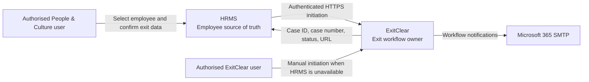
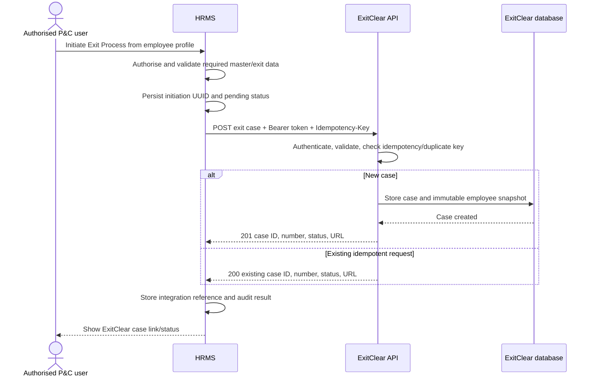
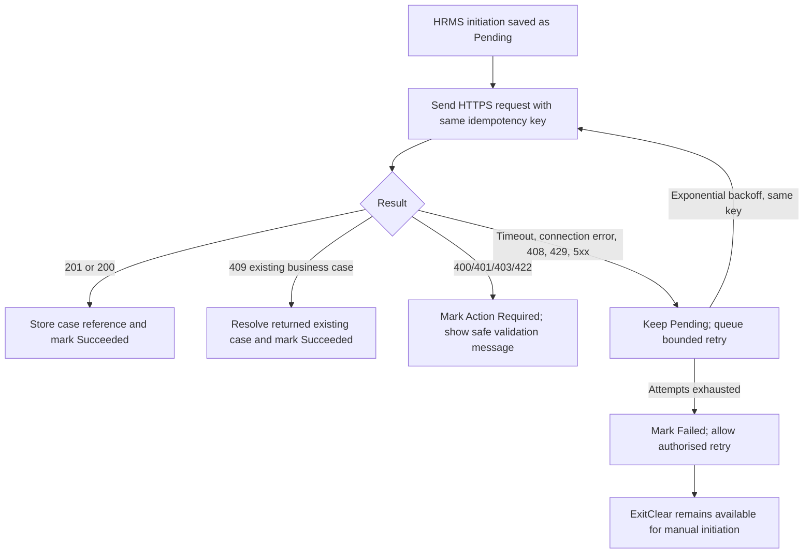

# ExitClear Integration Discovery

Status: discovery and integration planning only  
Reviewed application: People & Culture Records Management System (HRMS)  
Target application: ExitClear (separate Laravel application)  
Discovery date: 12 October 2026

## Executive conclusion

The HRMS can be the source of employee master data needed to initiate an ExitClear case. It already stores most of the required information and has a useful integration precedent in its WorkPulse implementation: bearer-token authentication, Laravel HTTP client calls, queued outbound employee synchronization, bounded retries, a paginated inbound directory endpoint, and scheduled reconciliation.

ExitClear should remain a separate system and own all clearance stages, assignments, approvals, recovery records, final documents, and case status. The HRMS should only initiate a case, retain a small integration reference, and provide navigation/status visibility. Direct cross-database access is not recommended.

The main data-quality dependency is the Line Manager link. A linked `supervisor_employee_id` provides a manager identity and work email. The legacy free-text `supervisor_name` does not provide a reliable email. Employee email, facility, project, department, job title, hire date, and employment status are also nullable, so initiation must validate required fields and allow an authorised user to confirm exit-specific data.

## 1. HRMS technical architecture summary

| Area | Finding |
| --- | --- |
| Framework | Laravel 12.58.0 |
| Language | PHP; Composer requires PHP `^8.2`. The inspected CLI is PHP 8.4.0. |
| UI | Server-rendered Blade application with Vite-managed frontend assets |
| ORM | Laravel Eloquent |
| Database | MySQL is the active configured driver. Laravel database configuration is environment-driven. |
| Authentication | Laravel Fortify with the `web` session guard and Eloquent `User` provider |
| Password reset | Fortify reset-password feature; tokens expire after 180 minutes |
| Authorization | Laravel policies and gates using role names plus province scoping |
| Queues | Database queue is the active configured connection; `jobs`, `job_batches`, and `failed_jobs` tables exist |
| Scheduler | Laravel Scheduler definitions in `routes/console.php` |
| Mail | Laravel Mail/Symfony Mailer using authenticated Microsoft 365 SMTP |
| Audit | Application-level `ActivityLogger` writes structured records to `activity_logs` |

No Supabase, SAML, OIDC, OAuth, Laravel Sanctum, or Laravel Passport implementation was found. User accounts are local HRMS accounts linked optionally one-to-one to employees.

### System context



## 2. Existing employee-data model

The employee source of truth is `App\Models\Employee`, backed by `employees`. The model uses soft deletion and exposes relationships to HR master data and to another employee as supervisor.

### Employee table

| Column | Database definition | ExitClear relevance |
| --- | --- | --- |
| `id` | `BIGINT UNSIGNED`, primary key | Current internal source identifier; stable while the HRMS record exists |
| `employee_no` | `VARCHAR`, unique, required | Preferred business identifier |
| `first_name` | `VARCHAR`, indexed, required | Snapshot name |
| `last_name` | `VARCHAR`, indexed, required | Snapshot name |
| `gender` | `VARCHAR`, nullable | Not required for ExitClear initiation |
| `date_of_birth` | Created as `DATE`, later converted to encrypted `TEXT` on MySQL; nullable | Sensitive; do not transfer |
| `national_id` | Created as `VARCHAR`, later converted to encrypted `TEXT` on MySQL; nullable | Sensitive; do not transfer |
| `email` | `VARCHAR`, nullable | Work email, but not explicitly typed as work/personal |
| `phone` | `VARCHAR`, nullable | Not required by the stated integration |
| `project_id` | Nullable FK to `projects.id` | Closest current representation of grant/project |
| `department_id` | Nullable FK to `departments.id` | Department |
| `job_title_id` | Nullable FK to `job_titles.id` | Position |
| `province_id` | Required FK to `provinces.id` | Province routing context |
| `district_id` | Required FK to `districts.id` | District/location context |
| `facility_id` | Nullable FK to `facilities.id` | Closest current duty-station field |
| `employment_status_id` | Nullable FK to `employment_statuses.id` | Active/Terminated status |
| `termination_reason_id` | Nullable FK to `termination_reasons.id` | Separation reason |
| `termination_date` | `DATE`, nullable, indexed | Current termination/end-date field; may serve as last working date only if business confirms semantics |
| `termination_comment` | `TEXT`, nullable; encrypted model cast | Sensitive free text; do not transfer by default |
| `hire_date` | `DATE`, nullable | Employee start date |
| `supervisor_name` | `VARCHAR`, nullable | Legacy/fallback Line Manager text |
| `supervisor_employee_id` | Nullable self-FK to `employees.id` | Preferred Line Manager relationship |
| `notes` | `TEXT`, nullable; encrypted model cast | Sensitive internal notes; do not transfer |
| `created_by` | Nullable FK to `users.id` | Record audit metadata |
| `updated_by` | Nullable FK to `users.id` | Record audit metadata |
| `archived_by` | Nullable FK to `users.id` | Archive audit metadata |
| `created_at`, `updated_at` | Timestamps | Change tracking |
| `deleted_at` | Nullable timestamp | Soft-delete/archive state |

`full_name` and `display_name` are model accessors, not stored columns. `display_name` is formatted as `{employee_no} - {full_name}`.

### Related master data

`departments`, `projects`, `job_titles`, `employment_statuses`, `provinces`, and `termination_reasons` use the following common structure:

- `id` - unsigned big integer primary key
- `name` - unique string
- `code` - nullable unique string
- `description` - nullable text
- `is_active` - indexed boolean
- `created_at`, `updated_at` - timestamps

Location hierarchy:

- `provinces`: common master-data fields.
- `districts`: `id`, required `province_id`, `name`, nullable `code`, nullable `description`, `is_active`, timestamps; unique by province and name.
- `facilities`: `id`, required `district_id`, `name`, nullable `code`, nullable `description`, `is_active`, timestamps; unique by district and name.

The Employee relationships relevant to ExitClear are:

- `project()` -> `Project`
- `department()` -> `Department`
- `jobTitle()` -> `JobTitle`
- `province()` -> `Province`
- `district()` -> `District`
- `facility()` -> `Facility`
- `employmentStatus()` -> `EmploymentStatus`
- `terminationReason()` -> `TerminationReason`
- `supervisor()` -> another `Employee` through `supervisor_employee_id`
- `directReports()` -> employees whose `supervisor_employee_id` points to this employee
- `user()` -> optional one-to-one HRMS login account

## 3. Available employee fields relevant to ExitClear

| ExitClear need | HRMS source | Availability/quality |
| --- | --- | --- |
| HRMS employee identifier | `employees.id` | Required DB primary key; no UUID |
| Employee number | `employees.employee_no` | Required and unique; preferred business key |
| Full name | `first_name`, `last_name`, `full_name` accessor | Required source fields |
| Work email | `employees.email` | Nullable and not explicitly classified as work email |
| Job title/position | `job_title_id` -> `job_titles` | Nullable |
| Grant | `project_id` -> `projects` | Nullable; confirm that Project is the accepted Grant concept |
| Department | `department_id` -> `departments` | Nullable |
| Province | `province_id` -> `provinces` | Required |
| District | `district_id` -> `districts` | Required |
| Duty station | `facility_id` -> `facilities` | Nullable; confirm Facility equals duty station |
| Employee start date | `hire_date` | Nullable |
| Employment status | `employment_status_id` -> `employment_statuses` | Nullable; employee forms currently permit Active or Terminated |
| Line Manager identity | `supervisor_employee_id` -> `employees` | Nullable but reliable when linked |
| Line Manager name | Linked supervisor `full_name`, otherwise `supervisor_name` | Fallback may be stale/free text |
| Line Manager work email | Linked supervisor `email` | Available only when manager is linked and has email |
| Last working/end date | `termination_date` | Nullable; semantics require confirmation |
| Separation reason | `termination_reason_id` -> `termination_reasons` | Nullable master data |
| Archive state | `deleted_at` | Soft-delete/archive indicator |

The existing seeded separation reasons are Resignation, End of Contract, Deceased, Redundancy, Dismissed, Discharged, and Ill Health. The requested ExitClear vocabulary also includes Pensioned, Transferred, Retrenched, Absconded, Misconduct, and Illness. The master data can be maintained, but the canonical vocabulary and mapping must be agreed before integration.

## 4. Missing or ambiguous employee/exit fields

- No employee UUID exists. `employees.id` is the internal source ID; `employee_no` is the unique business identifier.
- No distinct exit-event identifier exists. A future initiation record should generate an immutable UUID used for idempotency.
- No explicit `last_working_date` field exists separately from `termination_date`.
- No explicit `work_email` field exists; `email` is nullable and its business meaning is not enforced.
- No explicit `grant_id`; `project_id` appears to be the closest match.
- No explicit `duty_station_id`; `facility_id` appears to be the closest match.
- No effective-dated history for supervisor assignments exists.
- No guaranteed Line Manager email exists when only `supervisor_name` is populated.
- No ExitClear case ID, case number, URL, initiation status, idempotency key, or synchronization timestamp exists.
- No exit-clearance workflow, recovery ledger, or clearance-stage assignment model exists in HRMS, which is correct for the intended separation of responsibilities.

## 5. Current Line Manager modelling

Line Manager is correctly modelled as an employee-to-employee relationship rather than a permanent role:

```text
employees.supervisor_employee_id -> employees.id
Employee::supervisor()           -> belongsTo(Employee)
Employee::directReports()        -> hasMany(Employee)
```

`supervisor_name` remains as a legacy/fallback string. Employee forms populate it from the selected supervisor when `supervisor_employee_id` is chosen. The linked supervisor supplies employee number, name, and email. The fallback string supplies only a name and must not be used to infer an email.

Before ExitClear initiation, HRMS should require one of these outcomes:

1. A linked, active supervisor with a valid work email; or
2. An authorised user explicitly confirms/overrides the case-specific Line Manager identity and email in the initiation form.

The snapshot sent to ExitClear should preserve the selected manager at initiation even if the HRMS reporting line changes later.

## 6. Existing user and authorization model

The `users` table contains local application accounts with:

- `id` primary key
- nullable unique `employee_id` FK to `employees.id`
- name and unique email
- hashed password and remember token
- nullable `role_id` FK
- nullable `province_id` FK
- `is_active`
- `must_change_password`
- timestamps

Roles are Admin, HR Manager, HR Officer, and Viewer. Authorization is implemented through model policies and named gates:

- Admin and HR Manager can view and update all employee records.
- HR Officer can view/update employees only in the officer's assigned province.
- Viewer can view assigned-province employee data but cannot update it.
- Sensitive personal fields are restricted to Admin and HR Manager.
- Audit logs are restricted to Admin and HR Manager.
- User management is restricted to Admin.

Recommended future initiation authorization:

- Admin: allowed globally.
- HR Manager: allowed globally.
- HR Officer: allowed only for employees in the officer's assigned province, subject to business confirmation.
- Viewer: not allowed.

The integration endpoint itself must use a dedicated machine credential and must not rely on a browser session.

## 7. Existing HR workflow functionality

The HRMS already includes employee records, disciplinary cases, staff promotions, staff relocations, temporary appointments and extensions, staff establishment, organisation charts/reporting lines, recruitment, reports/exports, imports, notifications, and activity logs.

Termination is currently represented as an employee master-data update: employment status becomes Terminated and termination reason/date are required by validation. There is no existing multi-stage employee exit workflow. That workflow should remain exclusively in ExitClear.

## 8. Existing API and integration capabilities

### Inbound HRMS endpoints

The application does not have a separate `routes/api.php`; JSON endpoints currently live in `routes/web.php`.

Relevant existing endpoint:

```text
GET /api/integrations/workpulse/directory
Authorization: Bearer {dedicated integration token}
Middleware: workpulse.integration, throttle:60,1
Parameters:
  updated_since: optional date/datetime
  per_page: optional integer, 1-200, default 100
  page: optional integer, minimum 1
```

It returns employees including soft-deleted records, master-data references, linked supervisor, `updated_at`, and `deleted_at`. It is tested for token protection and a safe paginated response. Public careers JSON endpoints also exist, but they are unrelated to employee integration.

`GET /employees/search` returns employee search JSON for the HRMS UI, but it uses session authentication, policy authorization, province visibility, and a short result limit. It is not suitable as an ExitClear integration endpoint.

### Outbound HRMS patterns

WorkPulse provides the closest precedent:

- `SyncEmployeeToWorkPulse` is a queued job implementing `ShouldQueue`.
- It uses `Http::acceptJson()->withToken(...)->timeout(20)`.
- It retries up to five times with backoff intervals of 30, 120, 600, and 1,800 seconds.
- `EmployeeObserver` dispatches sync after save, delete, and restore commits.
- `workpulse:reconcile` performs a scheduled full reconciliation daily at 01:00 with overlap protection.
- Employee profile actions call WorkPulse synchronously for validation, invitation, resend, and status lookup.

This is a usable technical pattern, but ExitClear must have its own URL, credential, middleware, request schema, logs, and failure state. Credentials must not be shared between WorkPulse and ExitClear.

### Gaps in current integration infrastructure

- No generic integration client/service abstraction exists; WorkPulse HTTP calls are split across a job, command, and `EmployeeController`.
- No generic external-reference/integration table exists.
- No inbound webhooks were found.
- No OAuth2 client-credentials or certificate-based machine authentication exists.
- Current static bearer-token comparison is adequate for a small internal first phase only when protected by HTTPS, strong random credentials, rotation, rate limiting, and network restrictions.

## 9. Existing mail implementation

The HRMS uses Laravel Mail (Symfony Mailer) and application-specific `Mailable` classes.

| Setting | Observed configuration |
| --- | --- |
| Active mailer | `smtp` |
| Host | `smtp.office365.com` |
| Port | `587` |
| Scheme | `smtp` |
| Authentication | Configured; username/password values were not inspected or recorded |
| Global sender | `hrms-noreply@righttocare-zambia.org` |
| Global sender name | `Right to Care Zambia HRMS` |
| Configuration | `config/mail.php`, populated from environment variables |

Port 587 is the Microsoft 365 submission port. The runtime scheme is `smtp`; encryption is not explicitly forced by a separate setting in `config/mail.php`. Symfony Mailer ordinarily negotiates STARTTLS when the server advertises it, but production configuration should explicitly verify that encrypted transport is required rather than merely available.

Most current mail sends are synchronous using `Mail::to(...)->send(...)`. Mailables use Laravel's `Queueable` trait but do not implement `ShouldQueue`, so the trait alone does not queue delivery. The WorkPulse employee synchronization job is queued, but it is not an email job.

Scheduled emails use Laravel Scheduler. `appointments:notify-ending-soon` runs daily and sends 60-day and 30-day temporary-appointment reminders. Other scheduled commands handle HR lifecycle operations and WorkPulse reconciliation. A queue worker and `php artisan schedule:run`/`schedule:work` (or server cron) are operational dependencies.

The reserved `exitclear@righttocare-zambia.org` mailbox must be configured in the separate ExitClear deployment, not in this repository.

## 10. Recommended HRMS-to-ExitClear architecture

Use a narrow outbound integration owned by an HRMS service/action layer:

```text
Employee profile action
  -> authorise and validate
  -> create/persist an HRMS exit-initiation reference with UUID
  -> ExitClearClient sends authenticated HTTPS POST
  -> ExitClear creates or returns the idempotent case
  -> HRMS stores case ID, case number, URL, status and timestamps
```

Suggested future HRMS classes (not created in this phase):

- `App\Services\Integrations\ExitClear\ExitClearClient`
- `App\Actions\ExitClear\InitiateExitCase`
- `App\Jobs\RetryExitClearInitiation`
- A dedicated integration model/table such as `employee_exit_integrations`

Suggested ExitClear endpoint:

```text
POST /api/integrations/hrms/v1/exit-cases
```

Optional narrow status endpoint:

```text
GET /api/integrations/hrms/v1/exit-cases/{case_id}
```

Status retrieval can be on demand from the employee screen or periodically refreshed. A signed callback can be added later if HRMS genuinely needs near-real-time status. HRMS must not replicate individual clearance-stage state or workflow logic.

ExitClear must also provide an authorised manual case-creation path. Manual cases should use `source.system = manual`; operators may optionally record an HRMS employee number after verifying identity. A later link operation must be explicit and audited.

### HRMS to ExitClear initiation



## 11. Proposed initiation payload

Only data necessary to identify the employee, route the case, and preserve the historical initiation snapshot should be transferred.

```json
{
  "schema_version": "1.0",
  "source": {
    "system": "hrms",
    "initiation_id": "8e12f919-62f9-4c12-9793-d1bd37f89040",
    "initiated_at": "2026-10-12T09:30:00+02:00",
    "initiated_by": {
      "user_id": 12,
      "name": "People and Culture Officer",
      "email": "officer@example.org"
    }
  },
  "employee": {
    "hrms_id": 431,
    "employee_no": "16000",
    "first_name": "Albert",
    "last_name": "Mwango",
    "full_name": "Albert Mwango",
    "work_email": "albert.mwango@example.org",
    "hire_date": "2021-03-15",
    "employment_status": {
      "id": 1,
      "code": "ACTIVE",
      "name": "Active"
    },
    "job_title": {
      "id": 44,
      "code": "DCP",
      "name": "Deputy Chief of Party"
    },
    "department": {
      "id": 7,
      "code": "PROGRAMMES",
      "name": "Programmes"
    },
    "project": {
      "id": 3,
      "code": "ACTION_HIV",
      "name": "USAID Action HIV Project"
    },
    "location": {
      "province": { "id": 1, "code": "LUS", "name": "Lusaka" },
      "district": { "id": 5, "code": "LUSAKA", "name": "Lusaka" },
      "facility": { "id": 18, "code": "CHO", "name": "Central Head Office" }
    },
    "line_manager": {
      "hrms_id": 102,
      "employee_no": "FT0547",
      "full_name": "Example Manager",
      "work_email": "manager@example.org"
    }
  },
  "exit": {
    "last_working_date": "2026-11-30",
    "separation_reason": {
      "id": 1,
      "code": "RESIGNATION",
      "name": "Resignation"
    }
  }
}
```

Notes:

- `source.initiation_id` is the durable idempotency key and should also be sent in the `Idempotency-Key` header.
- `initiated_by` is audit context, not an ExitClear role assignment.
- Null optional master-data objects may be sent as `null`, but the HRMS form should block initiation for fields agreed as mandatory.
- ExitClear should store this employee section as an immutable case snapshot.
- ExitClear should not continuously overwrite a case snapshot when HRMS employee data changes.

## 12. Proposed response payload

For a newly created case, return HTTP 201. For a replay of the same idempotency key, return HTTP 200 with the same case identifiers.

```json
{
  "data": {
    "case_id": "7f39b356-749c-4f4d-b3bc-0f3304492c8e",
    "case_number": "EXIT-2026-0042",
    "status": "initiated",
    "url": "https://exitclear.example.org/exit-cases/7f39b356-749c-4f4d-b3bc-0f3304492c8e",
    "source_initiation_id": "8e12f919-62f9-4c12-9793-d1bd37f89040",
    "created_at": "2026-10-12T09:30:02+02:00"
  }
}
```

Validation errors should use HTTP 422 with field-level errors. Authentication failure should use 401/403. A duplicate business case submitted under a different idempotency key should use HTTP 409 and return the existing case reference when disclosure is safe.

## 13. Proposed authentication approach

For the first internal integration:

- Use HTTPS only.
- Use a dedicated, high-entropy ExitClear bearer token stored in each application's secret/environment store.
- Use separate credentials for each direction; do not reuse the WorkPulse token or a user password.
- Scope the credential to `exit-cases:create` and optionally `exit-cases:read`.
- Compare tokens in constant time and never log them.
- Apply rate limiting, network allow-listing where practical, rotation, and a documented revocation procedure.
- Add request correlation IDs and an `Idempotency-Key` header.

This aligns with the working WorkPulse pattern and has low operational complexity. If organisational security standards require centrally managed machine identity, replace the static token with OAuth2 client credentials or mTLS without changing the payload contract.

## 14. Idempotency and duplicate protection

HRMS should eventually persist one initiation row before making the request. That row should have a UUID and a unique business key representing the employee exit event.

Recommended controls:

- Unique `source_initiation_id` generated by HRMS.
- `Idempotency-Key: {source_initiation_id}` on every attempt.
- ExitClear unique constraint on `(source_system, source_initiation_id)`.
- Secondary duplicate guard on an agreed business key, for example `(source_system, employee_hrms_id, last_working_date)`, with an authorised override workflow for genuinely separate exit events.
- Repeated requests with the same key and same body return the original case.
- Same key with a materially different body returns HTTP 409.
- HRMS disables a second initiation action once it has a pending or successful integration row, while still allowing an explicit retry of the same initiation.

Employee number alone is insufficient for duplicate prevention because an employee can leave, return, and leave again.

## 15. Failure, retry, and timeout strategy



Recommended behavior:

- Use short connection and total timeouts (for example 5 seconds connect, 15-20 seconds total).
- On timeout, do not assume the case was not created; retry only with the same idempotency key.
- Retry network failures, 408, 429 (respect `Retry-After`), and 5xx responses with bounded exponential backoff.
- Do not automatically retry ordinary 4xx validation/authorization failures.
- Keep status as Pending while retryable work remains; expose safe status to HR without raw exception text.
- Record the last status code, safe error code/message, attempt count, and next retry time.
- Never block employee record updates because ExitClear is unavailable.
- Do not automatically initiate a manual duplicate in ExitClear merely because HRMS timed out; first search/reconcile by initiation ID.

## 16. What each system should store

### HRMS

Store only navigation and integration-operability data:

- local initiation UUID/idempotency key
- employee ID
- confirmed last working date and separation-reason reference used for initiation
- ExitClear case ID and case number
- ExitClear case URL or a route-safe identifier from which HRMS builds the URL
- high-level ExitClear status only if needed (`pending`, `initiated`, `in_progress`, `closed`, `cancelled`, `failed`)
- initiation actor/time, response time, last status check, attempt count, and safe last error code

Do not copy checklist answers, verifier decisions, detailed recovery information, returned asset details, or final PDFs into HRMS unless a future records-retention requirement explicitly demands it.

### ExitClear

Store an immutable employee/exit snapshot from the accepted initiation payload, the source initiation ID, and its own case/workflow records. Configurable responsibilities, backups, province routing, verifier order, effective dates, and stage applicability belong in ExitClear configuration tables, never in source code or the HRMS payload.

## 17. Audit requirements

HRMS already has `ActivityLogger` and `activity_logs` with actor, action, description, polymorphic subject, JSON properties, IP address, user agent, and timestamps.

Future HRMS audit events should include:

- `exitclear_initiation_requested`
- `exitclear_initiation_succeeded`
- `exitclear_initiation_failed`
- `exitclear_initiation_retried`
- `exitclear_case_opened`
- `exitclear_status_refreshed`

Log employee number, local initiation ID, ExitClear case number (after success), response category, attempt number, actor, and timestamps. Do not log bearer tokens, full payloads, national IDs, free-text termination comments, raw SMTP/API credentials, or unfiltered remote exception bodies.

ExitClear should independently audit manual creation, imported HRMS snapshot acceptance, assignment changes, every clearance decision, recovery entries, verifier actions, document generation, case closure, reopening, and integration calls.

## 18. Security and privacy considerations

- Use least-privilege service credentials and TLS.
- Do not expose a broad employee directory when a single-case initiation payload is sufficient.
- Validate HRMS authorization before any request leaves the application.
- Validate and normalise all inbound data again in ExitClear; never trust the source solely because it is internal.
- Allowlist expected payload fields and enforce size limits.
- Treat case URLs as internal links; do not place reusable secrets in query strings.
- Escape user-entered content in both applications and generated PDFs/emails.
- Keep ExitClear assignments configurable and effective-dated; do not send staff names as workflow configuration in each initiation.
- Protect integration logs and limit access because even minimal exit data is confidential.
- Define retention and deletion rules for ExitClear snapshots and final PDFs.
- Confirm whether a terminated employee's HRMS email remains valid before ExitClear sends employee-facing communication.

### Sensitive fields that should not be transferred

- `national_id` / passport number
- `date_of_birth`
- `gender` unless a confirmed requirement emerges
- `phone` unless a confirmed notification requirement emerges
- `notes`
- `termination_comment` or other unrestricted HR free text
- HRMS user password, password reset token, remember token, session data, or API tokens
- activity-log IP addresses and user agents
- disciplinary-case data
- recruitment/application data
- unrelated attachments and documents

The paper form's ID/passport field is intentionally excluded from the proposed payload.

## 19. Proposed future HRMS action location

The existing employee detail screen at `resources/views/employees/show.blade.php` is the correct future location. It already displays employment details, termination date/reason, Line Manager, recent HR history, direct reports, and WorkPulse integration actions.

Recommended future UI behavior:

- Add `Initiate Exit Process` in the employee page action area or a dedicated ExitClear card visible only to authorised users.
- Open a confirmation form rather than initiating immediately.
- Prefill employee master data but require confirmation of last working date, separation reason, and Line Manager.
- Display missing/invalid required fields before submission.
- After success, replace the create action with case number, high-level status, and `Open in ExitClear`.
- If the request is pending/failed, show a safe status and an authorised retry using the same initiation ID.

No button or UI change was made during this discovery phase.

## 20. Technical dependencies

- ExitClear HTTPS base URL and trusted certificate.
- Dedicated secret management for the ExitClear service credential.
- A final versioned request/response contract.
- A future HRMS integration-reference migration/model.
- A future ExitClear idempotency store and unique constraints.
- Running database queue worker for retries.
- Running Laravel scheduler/cron if periodic reconciliation is selected.
- DNS/firewall connectivity from HRMS to ExitClear.
- Shared clock accuracy for logs, token controls, and timestamps.
- Agreed separation-reason codes and location/grant semantics.
- Monitoring for failed queue jobs and integration failures.
- Backup, retention, privacy, and disaster-recovery rules for ExitClear records and PDFs.

## 21. Open questions

1. Does `termination_date` mean the final working day, payroll termination date, or system termination date?
2. Is `project` the official Grant value for the exit checklist, or must Department and Project both be shown?
3. Is `facility` always the employee's duty station? What is used when facility is null?
4. Which initiation fields are mandatory: work email, job title, department/project, facility, hire date, and linked Line Manager?
5. May HR Officers initiate exits in their assigned province, or only Admin/HR Manager?
6. Can an exit be initiated before the employee status is changed to Terminated? This is recommended, but must be confirmed.
7. Should HRMS set termination status/date before initiation, after ExitClear closure, or through a separate HR action?
8. What is the canonical separation-reason list and code mapping? In particular, how should Pensioned, Transferred, Retrenched, Absconded, Misconduct, and Illness map to current HRMS values?
9. Can a case proceed when the Line Manager is not linked or has no email? Who may provide the case-specific override?
10. May the Line Manager be outside the HRMS employee directory (consultant/external manager)?
11. What high-level ExitClear statuses, if any, must HRMS display?
12. Is on-demand status lookup sufficient, or is a signed callback/webhook required?
13. Who may cancel or correct an initiation made for the wrong employee/date?
14. How should rehired employees and multiple exit events be distinguished?
15. What retention period applies to snapshots, recovery information, and final PDFs?
16. Which application sends employee, manager, and departmental notifications after case creation? Recommended answer: ExitClear.
17. What are the exact closure dependencies between P&C and Payroll checklists?
18. Which stages apply by province/duty station, and who owns assignment maintenance in ExitClear?
19. Are service credentials managed manually, in a secrets vault, or through an organisational identity platform?
20. What should happen to an HRMS user account and WorkPulse account when ExitClear reaches final closure? This should be a separately approved integration, not assumed.

## 22. Recommended implementation phases

### Phase 1: contract and business-rule confirmation

- Resolve the open questions above.
- Approve the minimum payload and canonical separation-reason codes.
- Define authorisation, duplicate rules, status vocabulary, retention, and manual-case linking.
- Publish an OpenAPI contract before implementation.

### Phase 2: ExitClear integration foundation

- Build configurable stage/responsibility/verifier data in ExitClear.
- Build manual ExitClear case initiation first so the application remains independent.
- Implement the idempotent HRMS initiation endpoint and immutable snapshot.
- Add authentication, rate limits, audit logs, safe errors, and integration tests.

### Phase 3: HRMS initiation integration

- Add the dedicated ExitClear client/action and future integration-reference model.
- Add policy-controlled initiation form on the employee detail screen.
- Add queued retry and reconciliation behavior.
- Add HRMS activity-log events and tests for authorisation, privacy, idempotency, timeout, and duplicate handling.

### Phase 4: status/navigation and operational readiness

- Add case link and approved high-level status display.
- Add monitoring, failed-job alerting, credential rotation, runbooks, backups, and recovery tests.
- Complete user acceptance testing for integrated and manual/offline initiation.

### Phase 5: optional later integrations

- Add signed status callbacks only if on-demand status is insufficient.
- Consider separately approved account-deactivation or records-retention integrations.
- Do not add payroll deductions, repayment tracking, or hardcoded workflow staff.

## 23. Relevant source files inspected

### Employee and master data

- `app/Models/Employee.php`
- `app/Models/Department.php`
- `app/Models/Project.php`
- `app/Models/JobTitle.php`
- `app/Models/EmploymentStatus.php`
- `app/Models/Province.php`
- `app/Models/District.php`
- `app/Models/Facility.php`
- `app/Models/TerminationReason.php`
- `app/Http/Controllers/EmployeeController.php`
- `app/Http/Controllers/EmployeeSearchController.php`
- `app/Http/Requests/StoreEmployeeRequest.php`
- `app/Http/Requests/UpdateEmployeeRequest.php`
- `app/Policies/EmployeePolicy.php`
- `resources/views/employees/show.blade.php`

### Schema

- `database/migrations/2026_05_10_170000_create_employees_table.php`
- `database/migrations/2026_06_04_090000_add_supervisor_employee_id_to_employees_table.php`
- `database/migrations/2026_06_06_090000_create_termination_reasons_and_add_employee_termination_fields.php`
- `database/migrations/2026_05_22_110000_encrypt_employee_personal_data.php`
- `database/migrations/2026_05_08_120010_create_master_data_tables.php`
- `database/migrations/0001_01_01_000000_create_users_table.php`
- `database/migrations/2026_05_08_120000_create_roles_table.php`
- `database/migrations/2026_05_08_120020_add_phase_one_fields_to_users_table.php`
- `database/migrations/2026_05_11_130000_add_employee_id_to_users_table.php`
- `database/migrations/2026_05_11_120000_create_activity_logs_table.php`
- `database/migrations/0001_01_01_000002_create_jobs_table.php`

### Authentication, authorization, audit, mail, and scheduling

- `config/auth.php`
- `config/fortify.php`
- `config/mail.php`
- `config/queue.php`
- `config/services.php`
- `app/Models/User.php`
- `app/Models/Role.php`
- `app/Providers/FortifyServiceProvider.php`
- `app/Providers/AppServiceProvider.php`
- `app/Services/ActivityLogger.php`
- `app/Models/ActivityLog.php`
- `app/Mail/TemporaryAppointmentEndingSoonMail.php`
- `app/Mail/PasswordResetMail.php`
- `app/Console/Commands/NotifyTemporaryAppointmentsEndingSoon.php`
- `routes/console.php`

### Existing API/integration precedent

- `routes/web.php`
- `bootstrap/app.php`
- `app/Http/Controllers/Api/WorkPulseDirectoryController.php`
- `app/Http/Middleware/VerifyWorkPulseIntegrationToken.php`
- `app/Jobs/SyncEmployeeToWorkPulse.php`
- `app/Observers/EmployeeObserver.php`
- `app/Console/Commands/ReconcileWorkPulse.php`
- `tests/Feature/WorkPulseDirectoryApiTest.php`

## Discovery boundary confirmation

This document is the only repository artifact added during discovery. No application code, routes, buttons, migrations, packages, APIs, database records, seed data, environment variables, credentials, mail settings, or production configuration were changed. No secret values were included in this report.
